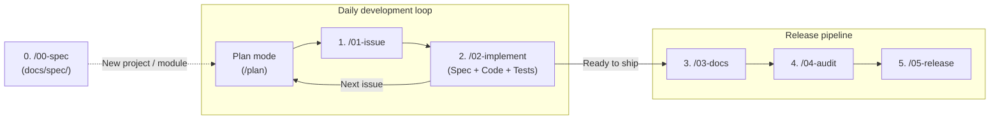

# agy-standards

[Google Antigravity](https://antigravity.google) (`agy`) plugin bundling global rules, lifecycle skills, and language-specific standards.

---

## Approach

`agy-standards` helps structure development with `agy` around a simple habit: **write down and agree on what you want to build before writing code.**

Instead of relying on long chat histories where requirements get lost, the workflow relies on two things:

- **Specifications (`docs/spec/`)**: Living requirements and design documents that describe how the project works (CLI flags, APIs, configuration, and behavior).
- **Issues**: Small, well-defined tasks that describe what needs to change, the edge cases to handle, and how to test it.

Because the requirements and design are written down up front, each coding or review step can run in a fresh session with clear boundaries.

---

## Workflow



1. **Write or update specs (`/00-spec`)**: Create initial `docs/spec/` files when starting a new project, adding a new module, or documenting existing code.
2. **Daily development loop (`Plan` $\rightarrow$ `/01-issue` $\rightarrow$ `/02-implement`)**:
   - **Plan (`--mode plan` / `/plan`)**: Discuss the problem and agree on the approach before touching code.
   - **Create issue (`/01-issue`)**: Turn the agreed plan into a structured issue draft (`.issue-draft.md`) with acceptance criteria, edge cases, and test cases.
   - **Implement (`/02-implement`)**: Create the branch (`git brx create issue/<id> -y`), update `docs/spec/` and the code together, run tests/linters, and open a PR (`git brx publish` $\rightarrow$ `git brx review`).
3. **Release pipeline (`/03-docs` $\rightarrow$ `/04-audit` $\rightarrow$ `/05-release`)**: When ready to release, review user docs, run a read-only audit across specs, code, and tests, and cut the release tag.

### Companion tool: [`git-brx`](https://github.com/bvarnai/git-brx) (optional, recommended)

`agy-standards` and [`git-brx`](https://github.com/bvarnai/git-brx) are designed as two halves of the same engineering workflow:

- **`agy-standards`** is the **cognitive & specification layer** (how `agy` plans, drafts issues, writes specs, codes, tests, and audits).
- **`git-brx`** is the **mechanical Git & tracker execution engine** (`git brx create`, `sync`, `update`, `resolve`, `publish`, `review`, `delete`).

`git-brx` is **recommended but not mandatory**: when `git-brx` is installed on `PATH`, [`rules/git.md`](rules/git.md) and `/02-implement` use it automatically for branch creation, linear rebase syncing, and PR submission; when it is not installed, `agy` falls back to standard `git` commands following the same trunk-based conventions.

---

## Repository layout

```text
agy-standards/
├── README.md                           # Architecture and usage guide
├── plugin.json                         # Native agy plugin manifest
├── rules/                              # Universal always-on rules (auto-loaded by plugin)
│   ├── GEMINI.md                       # Rule entrypoint (@-imports rules below + formatting & tool policy)
│   ├── spec-driven.md                  # Plan -> Issue -> Spec & Code rules
│   ├── git.md                          # Trunk-based branching, git-brx / git lifecycle & commit conventions
│   └── stack-routing.md                # CWD marker -> domain standard routing table
├── standards/                          # Stack-specific standards (routed via rules/stack-routing.md)
│   ├── go-cli.md                       # Go CLI architecture, error wrapping & testing
│   ├── java.md                         # Modern Java idioms, null-safety, Maven/Gradle verification
│   ├── embedded.md                     # Embedded C/C++ deterministic memory, ISR safety, HAL
│   └── shell.md                        # Bash/Shell naming (kebab-case CLI), safety, shellcheck & Bats
├── skills/                             # Universal lifecycle skills (agy slash commands)
│   ├── 00-spec/
│   │   ├── SKILL.md                    # Interactive spec authoring & domain template router
│   │   └── templates/
│   │       └── cli.md                  # Field-proven CLI spec templates (global.md + <subcommand>.md)
│   ├── 01-issue/SKILL.md               # Mandatory issue drafting template (.issue-draft.md)
│   ├── 02-implement/SKILL.md           # Spec sync, TDD implementation & git-brx branch/PR flow
│   ├── 03-docs/SKILL.md                # Documentation & tone audit
│   ├── 04-audit/SKILL.md               # Read-only pre-release or branch readiness audit
│   ├── 05-release/SKILL.md             # Version bump, changelog & release tag
│   ├── 06-harmonize/SKILL.md           # Cross-repo gap analysis & uplift plan
│   └── 07-models/SKILL.md              # Periodic model benchmark & compass updater
└── fragments/                          # Reusable blocks & contracts
    └── strict-technical-tone.md        # Concise developer-to-developer output constraint
```

---

## Universal lifecycle skills

Run these skills from inside the `agy` TUI or directly from your terminal:

### Core development & release lifecycle

| Stage | Slash command | CLI interactive (`agy -i`) | CLI headless / audit (`agy -p`) | Purpose |
| :--- | :--- | :--- | :--- | :--- |
| **0. Spec** | `/00-spec` | `agy --mode plan --effort high -i "/00-spec"` | — | Author or update technical specs in `docs/spec/`. |
| **1. Issue** | `/01-issue` | `agy --effort medium -i "/01-issue feat: add foo"` | `agy --effort medium -p "/01-issue feat: add foo"` | Draft strict, spec-driven issues. |
| **2. Implement** | `/02-implement` | `agy --effort medium -i "/02-implement #42"` | — | Implement features/fixes with spec sync & tests. |
| **3. Docs** | `/03-docs` | `agy --effort medium -i "/03-docs"` | `agy --effort medium -p "/03-docs"` | Audit docs for tone and factual accuracy. |
| **4. Audit** | `/04-audit` | `agy --effort high -i "/04-audit"` | `agy --effort high -p "/04-audit"` | Read-only release or branch readiness audit. |
| **5. Release** | `/05-release` | `agy --effort low -i "/05-release v1.2.0"` | — | Finalize changelog, bump version, stage tags. |

### Occasional & maintenance tasks

| Task | Slash command | CLI interactive (`agy -i`) | Purpose |
| :--- | :--- | :--- | :--- |
| **6. Harmonize** | `/06-harmonize` | `agy --mode plan --effort high -i "/06-harmonize"` | Compare two repos & plan structural uplift. |
| **7. Models** | `/07-models` | `agy --effort medium -i "/07-models"` | Review available models & update the compass table. |

### Model & effort mental compass

Choose the **model (`--model` / `/model`)** for its base instincts (**Gemini 4 Argon** for deep architectural synthesis vs. **Gemini 3.8** for surgical coding and fast tool loops) and **effort (`--effort`)** for per-turn thinking depth:

| Engineering goal | Lifecycle stages | Recommended model | Effort & mode | Why this combination works best |
| :--- | :--- | :--- | :--- | :--- |
| **System architecture, specs & cross-repo uplift** | `00-spec`<br>`06-harmonize` | **Gemini 4 Argon** | `--mode plan --effort high` | Deepest multi-file reasoning, legacy reverse-engineering, and interface/invariant synthesis before writing code. |
| **Pre-release readiness & cross-artifact audit** | `04-audit` | **Gemini 4 Argon**<br>*(or **Gemini 3.8** for branch diffs)* | `--effort high`<br>*(or `medium` for branch diffs)* | Holds Spec $\leftrightarrow$ Code $\leftrightarrow$ Docs $\leftrightarrow$ CI invariants in working memory simultaneously to catch subtle drift without false positives. |
| **Hands-on coding, TDD & tool execution loops** | `02-implement`<br>`01-issue` | **Gemini 3.8** | `--effort medium`<br>*(or `high` for race/concurrency bugs)* | Stronger coding instincts and surgical diffs; follows existing code style without over-abstraction and iterates faster across 10–20 edit/test steps. |
| **Documentation tone & accuracy review** | `03-docs` | **Gemini 3.8**<br>*(or **Gemini 4 Argon**)* | `--effort medium` | Verifies flags/examples against code while keeping developer prose direct, natural, and free of stiff AI phrasing. |
| **Mechanical release cut & changelog bump** | `05-release`<br>*(plus trivial `chore:`/`docs:` issues)* | **Gemini 3.8** *(or **Flash** / **Argon Low**)* | `--effort low` | Purely deterministic execution (SemVer bump, `CHANGELOG.md` move, Git tag staging); `low` prevents re-auditing and minimizes latency. |

---

## Multi-stack domain rule routing

Always-on [`rules/stack-routing.md`](rules/stack-routing.md) inspects the current working directory (`CWD`) during planning, issue drafting, implementation, and auditing to load the matching standard:

- **Go**: Triggered by `go.mod` $\rightarrow$ enforces [standards/go-cli.md](standards/go-cli.md) (`go test -race ./...`, `go vet ./...`).
- **Java**: Triggered by `pom.xml` / `build.gradle` $\rightarrow$ enforces [standards/java.md](standards/java.md) (`./mvnw test` / `./gradlew check`).
- **Embedded C/C++**: Triggered by `CMakeLists.txt` / `platformio.ini` / `Kconfig` / `*.ld` $\rightarrow$ enforces [standards/embedded.md](standards/embedded.md) (deterministic memory, fixed-width types, ISR safety).
- **Shell / Bash**: Triggered by `*.sh` / `*.bats` / `.bashrc.d/` $\rightarrow$ enforces [standards/shell.md](standards/shell.md) (`kebab-case` public interfaces, `shellcheck`, `bats`).

To add a new stack (e.g. Rust, Python), create `standards/<stack>.md` and add one row to `rules/stack-routing.md`.

---

## Configuring Antigravity (`agy`)

`agy-standards` is packaged as a native Antigravity plugin (`plugin.json`). Linking the repository into `~/.gemini/config/plugins/` automatically registers both the global rules (`rules/`) and all lifecycle skills (`skills/`) with a single directory symlink:

```bash
mkdir -p ~/.gemini/config/plugins
ln -sfn "<path-to-agy-standards>" ~/.gemini/config/plugins/agy-standards
```

---

## 🤖 AI Disclosure


This project was developed with the assistance of AI tools. All AI-generated code has been reviewed, tested, and manually refined.
