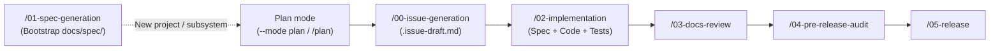

# agy-standards

[Google Antigravity](https://antigravity.google) (`agy`) plugin bundling global rules, lifecycle skills, and language-specific standards.

---

## Workflow

`docs/spec/` defines the living state of the system, and issues define each unit of change:



1. **Bootstrap specs (`/01-spec-generation`)**: Author initial `docs/spec/` files when starting a new project, adding a major subsystem, or reverse-engineering legacy code.
2. **Plan (`--mode plan` / `/plan`)**: Discuss and align on a feature, refactor, or fix before writing code.
3. **Create issue (`/00-issue-generation`)**: Turn the agreed plan into a structured issue (`.issue-draft.md`) with acceptance criteria, edge cases, and test plans.
4. **Implement (`/02-implementation`)**: Update `docs/spec/`, implement the code, and run automated tests and linters.
5. **Review, audit & release (`/03` $\rightarrow$ `/04` $\rightarrow$ `/05`)**: Refine user docs, run a read-only release audit, and cut the release tag.

---

## Repository layout

```text
agy-standards/
├── README.md                           # Architecture and usage guide
├── plugin.json                         # Native agy plugin manifest
├── rules/                              # Universal always-on rules (auto-loaded by plugin)
│   ├── GEMINI.md                       # Baseline rules (LF, Markdown formatting, Tool policy)
│   ├── spec-driven.md                  # Plan -> Issue -> Spec & Code rules
│   ├── git.md                          # Trunk-based branching, Conventional Commits & PR hygiene
│   └── stack-routing.md                # CWD marker -> domain standard routing table
├── standards/                          # Stack-specific standards (routed via rules/stack-routing.md)
│   ├── go-cli.md                       # Go CLI architecture, error wrapping & testing
│   ├── java.md                         # Modern Java idioms, null-safety, Maven/Gradle verification
│   ├── embedded.md                     # Embedded C/C++ deterministic memory, ISR safety, HAL
│   └── shell.md                        # Bash/Shell naming (kebab-case CLI), safety, shellcheck & Bats
├── skills/                             # Universal lifecycle skills (agy slash commands)
│   ├── 00-issue-generation/SKILL.md    # Mandatory issue drafting template (.issue-draft.md)
│   ├── 01-spec-generation/
│   │   ├── SKILL.md                    # Interactive spec authoring & domain template router
│   │   └── templates/
│   │       └── cli.md                  # Field-proven CLI spec templates (global.md + <subcommand>.md)
│   ├── 02-implementation/SKILL.md      # Spec-driven implementation + test verification
│   ├── 03-docs-review/SKILL.md         # Documentation & tone audit
│   ├── 04-pre-release-audit/SKILL.md   # One-shot pre-release readiness audit
│   ├── 05-release/SKILL.md             # Version bump, changelog & release tag
│   ├── 06-project-harmonization/SKILL.md # Cross-repo gap analysis & uplift plan
│   └── 07-model-compass/SKILL.md       # Periodic model benchmark & compass updater
└── fragments/                          # Reusable blocks & contracts
    └── strict-technical-tone.md        # Concise developer-to-developer output constraint
```

---

## Universal lifecycle skills

Run these skills from inside the `agy` TUI or directly from your terminal:

### Core development & release lifecycle

| Stage | Slash command | CLI interactive (`agy -i`) | CLI headless / audit (`agy -p`) | Purpose |
| :--- | :--- | :--- | :--- | :--- |
| **0. Issue** | `/00-issue-generation` | `agy --effort medium -i "/00-issue-generation feat: add foo"` | `agy --effort medium -p "/00-issue-generation feat: add foo"` | Draft strict, spec-driven issues. |
| **1. Spec** | `/01-spec-generation` | `agy --mode plan --effort high -i "/01-spec-generation"` | — | Author or update technical specs in `docs/spec/`. |
| **2. Code** | `/02-implementation` | `agy --effort medium -i "/02-implementation #42"` | — | Implement features/fixes with spec sync & tests. |
| **3. Docs** | `/03-docs-review` | `agy --effort medium -i "/03-docs-review"` | `agy --effort medium -p "/03-docs-review"` | Audit docs for tone and factual accuracy. |
| **4. Audit** | `/04-pre-release-audit` | `agy --effort high -i "/04-pre-release-audit"` | `agy --effort high -p "/04-pre-release-audit"` | Read-only release or branch readiness audit. |
| **5. Release** | `/05-release` | `agy --effort low -i "/05-release v1.2.0"` | — | Finalize changelog, bump version, stage tags. |

### Occasional & maintenance tasks

| Task | Slash command | CLI interactive (`agy -i`) | Purpose |
| :--- | :--- | :--- | :--- |
| **6. Harmonize** | `/06-project-harmonization` | `agy --mode plan --effort high -i "/06-project-harmonization"` | Compare two repos & plan structural uplift. |
| **7. Models** | `/07-model-compass` | `agy --effort medium -i "/07-model-compass"` | Review available models & update the compass table. |

### Model & effort mental compass

Choose the **model (`--model` / `/model`)** for its base instincts (**Gemini 4 Argon** for deep architectural synthesis vs. **Gemini 3.8** for surgical coding and fast tool loops) and **effort (`--effort`)** for per-turn thinking depth:

| Engineering goal | Lifecycle stages | Recommended model | Effort & mode | Why this combination works best |
| :--- | :--- | :--- | :--- | :--- |
| **System architecture, specs & cross-repo uplift** | `01-spec-generation`<br>`06-project-harmonization` | **Gemini 4 Argon** | `--mode plan --effort high` | Deepest multi-file reasoning, legacy reverse-engineering, and interface/invariant synthesis before writing code. |
| **Pre-release readiness & cross-artifact audit** | `04-pre-release-audit` | **Gemini 4 Argon**<br>*(or **Gemini 3.8** for branch diffs)* | `--effort high`<br>*(or `medium` for branch diffs)* | Holds Spec $\leftrightarrow$ Code $\leftrightarrow$ Docs $\leftrightarrow$ CI invariants in working memory simultaneously to catch subtle drift without false positives. |
| **Hands-on coding, TDD & tool execution loops** | `02-implementation`<br>`00-issue-generation` | **Gemini 3.8** | `--effort medium`<br>*(or `high` for race/concurrency bugs)* | Stronger coding instincts and surgical diffs; follows existing code style without over-abstraction and iterates faster across 10–20 edit/test steps. |
| **Documentation tone & accuracy review** | `03-docs-review` | **Gemini 3.8**<br>*(or **Gemini 4 Argon**)* | `--effort medium` | Verifies flags/examples against code while keeping developer prose direct, natural, and free of stiff AI phrasing. |
| **Mechanical release cut & changelog bump** | `05-release`<br>*(plus trivial `chore:`/`docs:` issues)* | **Gemini 3.8** *(or **Flash** / **Argon Low**)* | `--effort low` | Purely deterministic execution (SemVer bump, `CHANGELOG.md` move, Git tag staging); `low` prevents re-auditing and minimizes latency. |

---

## Multi-stack domain rule routing

Always-on [`rules/stack-routing.md`](rules/stack-routing.md) inspects the current working directory (`CWD`) during planning, issue drafting, implementation, and auditing to load the matching standard:

- **Go**: Triggered by `go.mod` $\rightarrow$ enforces [standards/go-cli.md](standards/go-cli.md) (`go test -race ./...`, `go vet ./...`).
- **Java**: Triggered by `pom.xml` / `build.gradle` $\rightarrow$ enforces [standards/java.md](standards/java.md) (`./mvnw test` / `./gradlew check`).
- **Embedded C/C++**: Triggered by `CMakeLists.txt` / `platformio.ini` / `Kconfig` / `*.ld` $\rightarrow$ enforces [standards/embedded.md](standards/embedded.md) (deterministic memory, fixed-width types, ISR safety).
- **Shell / Bash**: Triggered by `*.sh` / `*.bats` / `.bashrc.d/` $\rightarrow$ enforces [standards/shell.md](standards/shell.md) (`kebab-case` public interfaces, `shellcheck`, `bats`).

To add a new stack (e.g. Rust, Python), create `standards/<stack>.md` and add one row to `rules/stack-routing.md`.

---

## Configuring Antigravity (`agy`)

`agy-standards` is packaged as a native Antigravity plugin (`plugin.json`). Linking the repository into `~/.gemini/config/plugins/` automatically registers both the global rules (`rules/`) and all lifecycle skills (`skills/`) with a single directory symlink:

```bash
mkdir -p ~/.gemini/config/plugins
ln -sfn "<path-to-agy-standards>" ~/.gemini/config/plugins/agy-standards
```

---

## 🤖 AI Disclosure


This project was developed with the assistance of AI tools. All AI-generated code has been reviewed, tested, and manually refined.
