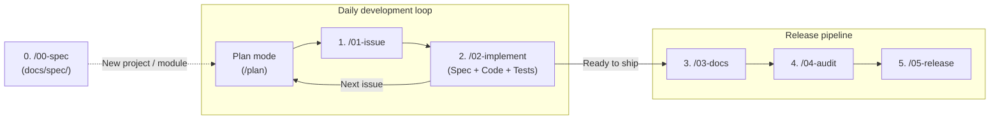

# agy-standards

[Google Antigravity](https://antigravity.google) (`agy`) plugin bundling global rules, lifecycle skills, and language-specific standards.

---

## Approach

`agy-standards` structures development with `agy` around one habit: **agree on what you want to build and put it in writing before any code exists.**

That written record replaces long chat histories, where requirements get lost, and takes two forms:

- **Specifications (`docs/spec/`)**: Living requirements and design documents that describe how the project works (CLI flags, APIs, configuration, and behavior).
- **Issues**: Small, well-defined tasks that describe what needs to change, the edge cases to handle, and how to test it.

Each coding or review step can then start in a fresh session and read what it needs from these files. *(See [docs/philosophy.md](docs/philosophy.md) for why the workflow is built this way.)*

---

## Workflow



1. **Write or update specs (`/00-spec`)**: Create initial `docs/spec/` files when starting a new project, adding a new module, or documenting existing code.
2. **Daily development loop (`Plan` $\rightarrow$ `/01-issue` $\rightarrow$ `/02-implement`)**:
   - **Plan (`--mode plan` / `/plan`)**: Discuss the problem and agree on the approach before touching code.
   - **Create issue (`/01-issue`)**: Turn the agreed plan into a structured issue draft (`.issue-draft.md`) with acceptance criteria, edge cases, and test cases.
   - **Implement (`/02-implement`)**: Create a topic branch, update `docs/spec/` and the code together, run tests and linters, and open a PR.
3. **Release pipeline (`/03-docs` $\rightarrow$ `/04-audit` $\rightarrow$ `/05-release`)**: When ready to release, review user docs, run a read-only audit across specs, code, and tests, and cut the release tag.

### Companion tool: [`git-brx`](https://github.com/bvarnai/git-brx) (optional)

`agy-standards` shapes how the agent plans, writes specs, codes, audits, and writes commits. `git-brx` serves a different purpose in the same workflow: it covers your side of it. It brings its own branching conventions and turns them into concrete commands (`git brx create`, `sync`, `publish`, `review`, and so on) on top of Git, so you can follow the workflow without being fluent in Git. It also ships its own agent skill; see its [AI agent integration guide](https://github.com/bvarnai/git-brx/blob/main/docs/user-guide/getting-started.md).

If `git-brx` is on `PATH`, the agent uses it for branches, syncing, and PRs. If not, the agent follows the project's own conventions.

### Working effectively

- **Use plan mode as an interview.** Give a rough 2-sentence idea and ask `agy` to challenge the edge cases and trade-offs. Answering a few sharp questions triggers the same design thinking that used to happen while coding by hand. Then let `/00-spec` or `/01-issue` draft the Markdown from your answers.
- **Prototype when the design isn't clear yet.** Build a rough, throwaway version to learn what works, then write the real design into `docs/spec/`.
- **Use the fast path for trivial changes.** Small fixes, doc edits, and dependency bumps don't need an issue.

---

## Repository organization

```text
agy-standards/
├── plugin.json                         # Native agy plugin manifest
├── rules/                              # Universal always-on rules (auto-loaded by plugin)
│   ├── GEMINI.md                       # Rule entrypoint (@-imports rules below + formatting & tool policy)
│   ├── spec-driven.md                  # Plan -> Issue -> Spec & Code rules
│   ├── git.md                          # Commit conventions
│   └── stack-routing.md                # CWD marker -> domain standard routing table
├── standards/                          # Stack-specific standards (routed via rules/stack-routing.md)
│   ├── go-cli.md                       # Go CLI architecture, error wrapping & testing
│   ├── java.md                         # Modern Java idioms, null-safety, Maven/Gradle verification
│   ├── embedded.md                     # Embedded C/C++ deterministic memory, ISR safety, HAL
│   └── shell.md                        # Bash/Shell naming (kebab-case CLI), safety, shellcheck & Bats
├── skills/                             # Lifecycle slash commands (/00-spec .. /07-models)
│   └── <NN-skill>/SKILL.md             # Skill definition (+ templates/ where applicable)
└── fragments/                          # Shared prompt constraints (e.g., strict-technical-tone.md)
```

---

## Universal lifecycle skills

Run these skills inside an interactive `agy` session, or invoke supported stages headlessly with `agy -p`:

### Core development & release lifecycle

| Stage | Slash command | Mode & effort | CLI headless (`agy -p`) | Purpose |
| :--- | :--- | :--- | :--- | :--- |
| **0. Spec** | `/00-spec` | `plan`, `high` | — | Author or update technical specs in `docs/spec/`. |
| **1. Issue** | `/01-issue` | `medium` | `agy --effort medium -p "/01-issue feat: add foo"` | Draft strict, spec-driven issues. |
| **2. Implement** | `/02-implement` | `medium` | — | Implement features/fixes with spec sync & tests. |
| **3. Docs** | `/03-docs` | `medium` | `agy --effort medium -p "/03-docs"` | Audit docs for tone and factual accuracy. |
| **4. Audit** | `/04-audit` | `high` | `agy --effort high -p "/04-audit"` | Read-only pre-release readiness audit. |
| **5. Release** | `/05-release` | `low` | — | Prepare changelog/manifests and tag default branch. |

### Occasional & maintenance tasks

| Task | Slash command | Mode & effort | Purpose |
| :--- | :--- | :--- | :--- |
| **6. Harmonize** | `/06-harmonize` | `plan`, `high` | Compare two repos & plan structural uplift. |

### Model & effort mental compass

Start your `agy` session in **Build** (`medium`) as the default, then shift up to **Think** or down to **Mechanical** only when the stage calls for it:

| Gear | When to use | Stages | Model profile | Effort & mode |
| :--- | :--- | :--- | :--- | :--- |
| **1. Think** | Designing architecture, catching subtle drift, or stuck on a hard bug | `00-spec`, `06-harmonize`, `04-audit` | Strongest reasoning model | `high` *(+ `plan` for `00-spec` / `06-harmonize`)* |
| **2. Build** *(default)* | Day-to-day coding, tests, issue drafting, and doc reviews | `01-issue`, `02-implement`, `03-docs` | Fast, surgical coding model | `medium` |
| **3. Mechanical** | Deterministic steps where deep reasoning adds latency, not value | `05-release`, trivial `chore:` / `docs:` | Fastest available (or same model) | `low` |

For concrete model picks and per-stage rationale, see [docs/models.md](./docs/models.md).

---

## Multi-stack domain rule routing

Always-on [`rules/stack-routing.md`](rules/stack-routing.md) inspects the current working directory (`CWD`) during planning, issue drafting, implementation, and auditing to load the matching standard:

- **Go**: Triggered by `go.mod` $\rightarrow$ enforces [standards/go-cli.md](standards/go-cli.md) (`go test -race ./...`, `go vet ./...`).
- **Java**: Triggered by `pom.xml` / `build.gradle` $\rightarrow$ enforces [standards/java.md](standards/java.md) (`./mvnw test` / `./gradlew check`).
- **Embedded C/C++**: Triggered by `CMakeLists.txt` / `platformio.ini` / `Kconfig` / `*.ld` $\rightarrow$ enforces [standards/embedded.md](standards/embedded.md) (deterministic memory, fixed-width types, ISR safety).
- **Shell / Bash**: Triggered by `*.sh` / `*.bats` / `.bashrc.d/` $\rightarrow$ enforces [standards/shell.md](standards/shell.md) (`kebab-case` public interfaces, `shellcheck`, `bats`).

To add a new stack (e.g. Rust, Python), create `standards/<stack>.md` and add one row to `rules/stack-routing.md`.

---

## Configuring Antigravity (`agy`)

`agy-standards` is packaged as a native Antigravity plugin (`plugin.json`). Linking the repository into `~/.gemini/config/plugins/` automatically registers both the global rules (`rules/`) and all lifecycle skills (`skills/`) with a single directory symlink:

```bash
mkdir -p ~/.gemini/config/plugins
ln -sfn "<path-to-agy-standards>" ~/.gemini/config/plugins/agy-standards
```

---

## 🤖 AI Disclosure


This project was developed with the assistance of AI tools. All AI-generated code has been reviewed, tested, and manually refined.
